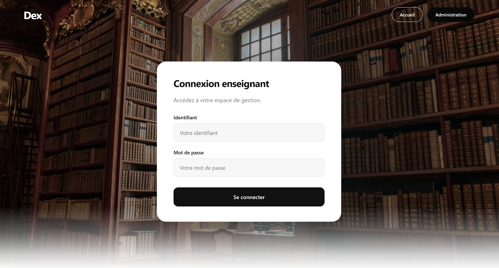

# Dex — Assignment and Availability Management

A full-stack web application developed as part of the **Web 2 (420-248-AH)** course.

Dex allows students to browse their courses, view assignments, and register for available time slots. Teachers can manage assignments, organize availability, and monitor student registrations through a dedicated dashboard.

## Application Preview

### Student Dashboard


### Teacher Dashboard



## Features

### Student Portal
- Browse courses and assignments.
- View assignment details and deadlines.
- Explore available time slots for each assignment.
- Register for available time slots.

### Teacher Portal
- Login and logout.
- View and manage assignments through a dashboard.
- Edit assignment information.
- Create, update, and delete time slots.
- View the number of students registered for each time slot.

### User Interface
- Clean, modern, minimalist, and responsive design.
- Navigation between the homepage, assignments, and administration.
- Smooth scrolling powered by Lenis.

## Tech Stack

| Category | Technologies |
| --- | --- |
| Frontend | HTML, CSS, JavaScript, PHP, Vue 3 |
| Backend | Node.js, Express |
| Database | MySQL |
| Authentication | bcrypt |
| Local Development | XAMPP, npm |
| Smooth Scrolling | Lenis |

## Project Structure

```text
dex-fullstack/
├── api/                  # Express server and MySQL integration
├── site/                 # Frontend application
│   ├── css/              # Stylesheets
│   ├── js/               # JavaScript files
│   ├── images/           # Application assets
│   ├── preview/          # Application screenshots
│   │   ├── EspaceEtudiant.png
│   │   └── EspaceEnseignant.png
│   ├── index.php         # Student homepage
│   ├── travail.php       # Assignment details
│   └── admin.php         # Teacher dashboard
├── init.sql              # Database initialization
└── README.md
```

## Getting Started

### Prerequisites
- Node.js and npm
- XAMPP (Apache and MySQL)
- A modern web browser
- Git

### 1. Clone the Repository

```bash
git clone https://github.com/Sara-Belhadj/dex-fullstack.git
cd dex-fullstack
```

For the local URLs below to work, place the project inside your XAMPP `htdocs` directory:

```text
C:\xampp\htdocs\dex-fullstack
```

### 2. Set Up the Database

1. Start **Apache** and **MySQL** using XAMPP.
2. Open phpMyAdmin at `http://localhost/phpmyadmin`.
3. Create a database named `DexAppBD`.
4. Import the `init.sql` file.

### 3. Configure the Backend

Inside the `api/` directory, create a `.env` file:

```dotenv
DB_HOST=localhost
DB_USER=root
DB_PASSWORD=
DB_NAME=DexAppBD
PORT=3000
```

> These settings are intended for local development. Never commit real passwords, credentials, or your `.env` file to GitHub.

### 4. Start the API

Open a terminal and run:

```bash
cd api
npm install
npm run dev
```

The backend should be available at `http://localhost:3000`.

### 5. Run the Application

With Apache, MySQL, and the API running, open:

**Student Portal:** `http://localhost/dex-fullstack/site/index.php`

**Teacher Portal:** `http://localhost/dex-fullstack/site/admin.php`

Make sure the API URL configured in `site/js/config.js` matches your local environment.

## API Endpoints

The backend provides REST API endpoints for managing courses, assignments, authentication, and availability.

| Method | Endpoint | Description |
| --- | --- | --- |
| GET | `/api` | Check API status |
| GET | `/api/cours` | Retrieve all courses |
| GET | `/api/travaux` | Retrieve assignments |
| GET | `/api/travaux/:id/disponibilites` | Retrieve available time slots |
| POST | `/api/connexion` | Authenticate a teacher |
| POST | `/api/deconnexion` | Log out a user |

Additional endpoints support assignment management and time slot creation, modification, and deletion.

## Project Background

Dex is an academic full-stack development project created to apply concepts learned in the Web 2 course, including:

- Client-server communication
- RESTful API development
- MySQL database integration
- Authentication and session management
- Dynamic user interfaces with Vue.js
- Frontend and backend integration

## Author

**Sara Belhadj**

[GitHub Profile](https://github.com/Sara-Belhadj)
